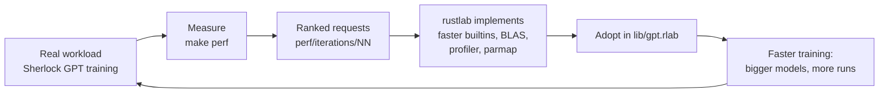
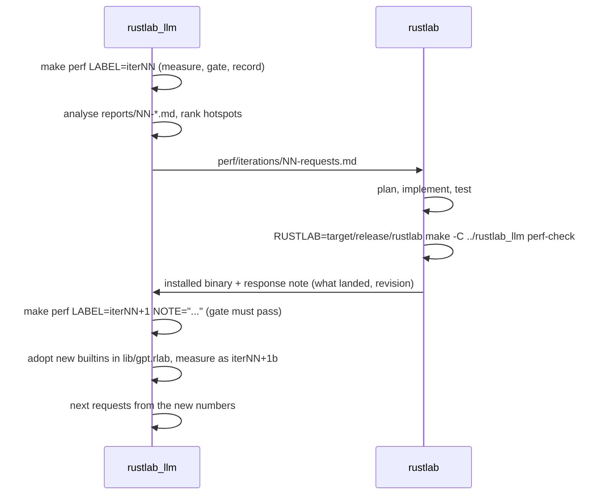

# The rustlab performance flywheel

How `rustlab` and `rustlab_llm` work together to make rustlab fast
enough to train language models. `rustlab_llm` supplies the workload,
the measurements, and ranked requests. `rustlab` supplies the
improvements. Each turn is recorded, so every speedup traces to a
rustlab revision and every request to a measurement.

This document is the contract between the two projects. Either side, a
person or an agent, can pick up a turn from it without having seen the
previous one. The operating details on this side, such as commands,
files, and noise rules, are in [`perf/README.md`](../perf/README.md).



## Why a flywheel

The loop compounds. Each turn makes the next one cheaper and better
aimed, and three effects carry the momentum:

- **Faster training buys sharper measurements.** A 20-minute training run limits how many experiments fit in a day. At 3 minutes, the harness can afford longer, quieter benchmarks and larger model sizes, and those expose the next bottleneck sooner.
- **Better profiling aims every later turn.** A request that makes rustlab's profiler see inside user functions pays off once in speed and again in every later diagnosis. That is why it is in the first round.
- **Library adoption turns rustlab features into training speed.** When rustlab ships a builtin, such as a GELU derivative or a batched matrix multiply, `lib/gpt.rlab` uses it in the same turn. The gain then shows up in the training workload, not only in a micro-benchmark, and that becomes the evidence for the next request.

Momentum depends on keeping each turn small: at most four requests,
measured within the same session that rustlab lands them. A turn that
stalls, for example a request too large to land, should be reshaped into
a smaller first step rather than left open.

## Why a loop and not a wish list

A one-off request list goes stale the moment the first item lands,
because the hotspot moves. After a faster matrix multiply, the interpreter
overhead that was 15 % of a training step becomes 40 %. Each turn
therefore re-measures and re-ranks, and asks for only the few changes
that pay most now. The measurements also guard correctness: the same
harness that reports the speedup checks that gradients and a fixed
training trajectory did not change.

## Roles and boundaries

| | rustlab_llm (this repo) | rustlab |
|---|---|---|
| Owns | The workload (`lib/gpt.rlab`, `tutorial/sherlock/`), the harness (`perf/`), the correctness gate, the measurement history | The language, the interpreter, the builtins, the profiler |
| Produces each turn | A report (`perf/reports/NN-*.md`) and a request file (`perf/iterations/NN-requests.md`) | An implementation, an installed binary, and a response note |
| Never does | Edit `../rustlab`. Requests leave as files. | Edit `rustlab_llm`. Responses come back as a binary plus a note. |
| Decides | What to ask for, ranked by measured impact | How to implement it, and whether a request is feasible or should be reshaped |

A request states the problem, the measured evidence, and the acceptance
target. It may suggest an implementation, such as BLAS `dgemm`, but rustlab
is free to meet the target another way, or to push back with a cheaper
alternative.

## The turn



1. **Measure (rustlab_llm).** Run `make perf LABEL=<label> NOTE="<what changed>"` on a quiet machine. It runs `perf/bench_suite.rlab`, `perf/gate.rlab`, and `perf/profile_step.rlab` under `--profile`, and records `perf/history/NN-label.json` with the rustlab version, binary timestamp, and source revision. It writes `perf/reports/NN-label.md` with speedups against the previous run and the baseline. It exits non-zero if the gate fails.
2. **Analyse (rustlab_llm).** Rank the parts of a training step by share of time, using the report's step breakdown, its per-workload table, and the profile. A part is worth a request when removing it would speed up `e2e.train_step_B8` by 10 % or more.
3. **Request (rustlab_llm).** Write `perf/iterations/NN-requests.md` from the template below. Ask for at most four items, highest measured payoff first. Each item gives the evidence, the benchmark keys it should move, and the target values. Hand the file to rustlab, for example by giving its path or its contents to the agent working in `../rustlab`.
4. **Implement (rustlab).** Record the request in rustlab's own planning, for example in `dev/plans/` and on the roadmap, so it follows rustlab's normal workflow and review. Implement it and run rustlab's own tests.
5. **Self-check (rustlab, optional but recommended).** Before installing, run this project's harness against the development build without recording anything:

   ```sh
   RUSTLAB=$PWD/target/release/rustlab make -C ../rustlab_llm perf-check
   ```

   It prints the same report, including the gate, against the last recorded run. A request is done when its keys reach their targets and the gate passes.
6. **Respond (rustlab).** Install the binary. Write a response note from the template below: what landed, the revision, any request reshaped or declined and why, and the numbers from the self-check. Put it in rustlab's changelog or plan file, and hand it back the same way the request came.
7. **Verify (rustlab_llm).** Run `make perf LABEL=iterNN NOTE="<from the response>"`. Mark each request in the iteration file as met, partly met, or not met, with the measured value.
8. **Adopt (rustlab_llm).** If rustlab added something the library should call, such as a builtin GELU derivative or a batched matrix multiply, change `lib/gpt.rlab` to use it. Then run `make sherlock-test` and `make perf-gate`, and record a separate run labelled `iterNNb`. Keeping that run separate keeps rustlab's gain and the library's gain distinguishable.
9. **Repeat** from step 2 with the new numbers.

## Acceptance and correctness

- **The gate is not negotiable.** The finite-difference gradient check must stay below 1e-6. The fixed-seed 25-step training trajectory must match `perf/reference/gate.json` to within a relative 1e-6. Reordered floating-point sums pass; changed results do not. A change that alters precision on purpose, such as an `f32` mode, is requested with its own explicit tolerance and a separate gate run, and never replaces the `f64` default silently.
- **Targets are on benchmark keys.** Every request names keys, for example `prim.matmul_512x512x512 ≥ 40 GFLOP/s`. A request is met when the recorded run reaches the target and the gate passes.
- **Noise floor.** On the same binary, workloads vary by a median of 1.5 % between runs, nearly all within 10 %. Changes under 10 % count only if they repeat.
- **No regressions.** The report flags any workload more than 10 % slower than the previous run. A flagged regression is raised in the next request file even when the headline improved.
- **Stopping rule.** The loop pauses when a turn improves `e2e.train_step_B8` by less than 10 %, or when the goal is reached: 17,000 tokens/s for the default 811 k-parameter model on the reference machine, roughly PyTorch on the same CPU.

## Request file template (`perf/iterations/NN-requests.md`)

```markdown
# Perf loop iteration NN: requests to rustlab

Measured on: perf/reports/NN-label.md (rustlab X.Y.Z, source <sha>)
Training step now: <tok/s> (e2e.train_step_B8); goal 17,000 tok/s.

## Summary
| # | Request | Share of step it attacks | Expected e2e gain | Keys and targets |

## R1: <title>
**Evidence.** <measured numbers, report section, code location if known>
**Problem.** <what is slow and why, in rustlab terms>
**Suggested approach.** <optional; rustlab may choose another>
**Acceptance.** <key ≥ target, ...>; gate PASS.
**Library follow-up.** <what lib/gpt.rlab will change to use it, if anything>

## Deferred to later iterations
<items measured but not yet worth asking for, with their current share>

## Outcome (filled in after verification)
| # | Status | Measured | Note |
```

## Response note template (rustlab side)

```markdown
## Perf loop iteration NN: response
Revision: <sha> (rustlab X.Y.Z), installed <date>
| # | Status (landed / partial / declined / reshaped) | What changed | Self-check numbers |
Notes: <behaviour changes, new builtins the library should adopt, caveats>
```

## Current state

| Iteration | Report | Requests | Training step |
|---|---|---|---|
| 00 baseline | [`perf/reports/00-baseline.md`](../perf/reports/00-baseline.md) | [`perf/iterations/01-requests.md`](../perf/iterations/01-requests.md) | 2,246 tok/s (rustlab 0.3.9) |
| 01 rustlab 0.3.10 | [`perf/reports/01-iter01.md`](../perf/reports/01-iter01.md) | 01: R1, R2, R4 met, R3 partly met | 8,859 tok/s (3.94×) |
| 01b library adoption | [`perf/reports/02-iter01b.md`](../perf/reports/02-iter01b.md) | `gelu_grad` builtin; vectorized positional encoding | 9,967 tok/s (4.44×) |
| 03 suite v2, same binary | [`perf/reports/03-suite-v2.md`](../perf/reports/03-suite-v2.md) | [`perf/iterations/02-requests.md`](../perf/iterations/02-requests.md), open | 9,542 tok/s (within noise of 01b) |

Update this table at the end of every turn.
