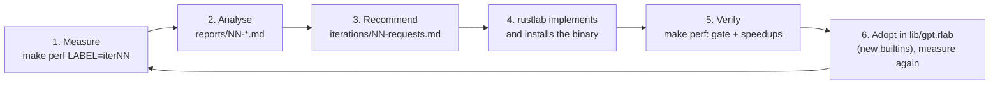

# rustlab performance flywheel: this repo's side

The cross-project contract, roles, templates, and the reasoning behind
the flywheel are in [`docs/perf-flywheel.md`](../docs/perf-flywheel.md).
This page is the operating guide for the harness in this folder.

An iterative cycle for making rustlab fast enough to train the Sherlock
GPT (`tutorial/sherlock/`, `lib/gpt.rlab`). Each turn measures the
training workload, finds where the time goes, asks rustlab for the change
with the largest measured payoff, then re-measures once rustlab has landed
it. The record of every turn stays in this folder, so the gains, and any
regressions, can be traced to a rustlab revision.

This repository never edits `../rustlab`. Requests leave as files in
`iterations/`, and improvements come back as a new rustlab binary.



## One turn, step by step

| Step | Who | What |
|---|---|---|
| 1. Measure | this repo | `make perf LABEL=baseline` (first time) or `LABEL=iterNN NOTE="what changed"`. Runs the benchmark suite, the correctness gate, and the profiler workload, then records `history/NN-label.json` and `reports/NN-label.md`. About 15 s. |
| 2. Analyse | this repo | Read the report: the headline speedups against the previous run and the baseline, where a training step goes, every workload with any regression over 10 % flagged, and the `--profile` table. |
| 3. Recommend | this repo | Write `iterations/NN-requests.md`: at most four requests, ranked by measured impact on `e2e.train_step_B8`. Each request names the benchmark keys it should move and the target value. |
| 4. Implement | rustlab | Implement, build, and install `rustlab`. Put the revision in the commit message so `run.py` records it (it reads `../rustlab`'s `HEAD` when that checkout exists). |
| 5. Verify | this repo | `make perf LABEL=iterNN NOTE="..."`. The gate must pass. A request is met when its keys reach the target. Anything that moved less than 10 % is noise (see below). |
| 6. Adopt | this repo | When rustlab adds something the library can call (a builtin, a batched op), change `lib/gpt.rlab` to use it, run `make sherlock-test`, then measure again as `iterNNb`, so rustlab's gain and the library's gain stay separate. |

Then the next turn starts from the new numbers.

## What is measured

`bench_suite.rlab` prints one `PERF <key> <ms> <rate> <unit>` line per workload. Every number is a median of repeated runs, timed with `tic`/`toc`. A key never changes meaning. New workloads get new keys, and older runs show `—` for them.

| Prefix | Workloads |
|---|---|
| `prim.` | Matrix multiplies at the model's exact shapes; elementwise, `tanh`, `gelu`, the library's GELU derivative, `softmax`, LayerNorm, transpose, row and column slices, region writes, row broadcast, the embedding scatter-add loop, and a scalar loop. |
| `flat.` | Per-step optimizer work on the 811,008-element parameter vector: axpy, sum of squares, clipping, AdamW, reducing 8 gradient rows, flatten, and unflatten. |
| `model.` | `gpt_forward`, `gpt_backward`, `gpt_grad_flat`, and greedy generation at the default model size (d 128, 4 layers, 4 heads, context 128). |
| `par.` | `parmap` over 1, 8, and 14 windows. |
| `e2e.` | One complete training step with a batch of 8, exactly as `tutorial/sherlock/train.rlab` does it. This is the number the loop optimizes. |

`gate.rlab` is the correctness gate. A finite-difference gradient check must stay below 1e-6. A fixed-seed, fully serial 25-step AdamW run must also reproduce `reference/gate.json` to within a relative 1e-6. The reference is written by the first recorded run on unmodified rustlab 0.3.9. Rounding differences from reordered sums, as BLAS or threading may cause, pass. Wrong arithmetic does not. A change that alters precision on purpose, such as an `f32` mode, needs its own looser gate, agreed in that iteration's requests.

`profile_step.rlab` runs under `rustlab run --profile`. Since rustlab 0.3.10, the profile shows nested user functions with inclusive and self time, a `[matmul]` row, and `parmap:<name>` rows for worker CPU time. `rustlab run --profile=ops` adds operator and indexing rows. `run.py` stores the table and sorts the report by self time. In 0.3.9 the profiler recorded only outermost user functions; fixing that was iteration 01's R2.

## Rules

- **Noise.** Two runs on the same binary differ by a median of 1.5 % per workload. Nearly all stay within 10 %, and `par.grad_flat_B14` swings about 20 %. Treat changes under 10 % as noise unless they repeat.
- **Quiet machine.** Do not measure while a training run, a build, or another benchmark is running.
- **One change per turn where possible.** If rustlab lands several requests at once, record one run and note all of them in `NOTE`.
- **Never edit history.** Records in `history/` and `reports/` are append-only. Only a deliberate change to the gate itself regenerates `reference/gate.json`, and its iteration file must say why.
- **Stopping rule.** Stop when an iteration improves `e2e.train_step_B8` by less than 10 %, or when it passes the current goal.

## Goal

| | Baseline (rustlab 0.3.9) | Goal |
|---|---:|---:|
| `e2e.train_step_B8` | 2,246 tok/s on 0.3.9; 9,967 after iteration 01 | 17,000 tok/s, roughly PyTorch on the same CPU |
| Default Sherlock run (3,000 steps) | 20 min on 0.3.9; about 5 min after iteration 01 | under 3 min |

## Files

| Path | Role |
|---|---|
| `bench_suite.rlab` | The fixed workloads (`PERF` lines). |
| `gate.rlab` | The correctness gate (`GATE` lines). |
| `profile_step.rlab` | The workload run under `--profile`. |
| `run.py` | Runs all three, records, compares, and writes the report. Exits non-zero if the gate fails. |
| `history/NN-label.json` | Raw record of each turn, including the environment and rustlab revision. |
| `reports/NN-label.md` | Human-readable comparison for each turn. |
| `reference/gate.json` | The gate's reference trajectory. |
| `iterations/NN-requests.md` | What was asked of rustlab in each turn, with acceptance targets. |

## Commands

```sh
make perf LABEL=iter01 NOTE="real dgemm fast path"   # measure, record, compare
make perf-check                                      # measure and compare without recording
make perf-gate                                       # correctness gate only (about 1 s)
```
