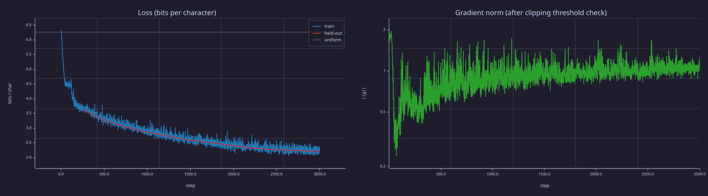
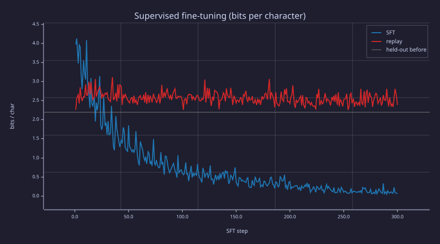
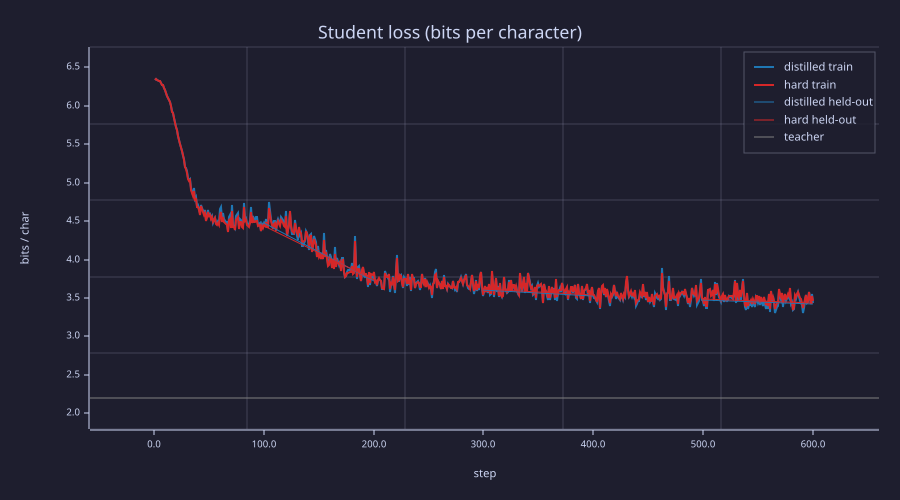
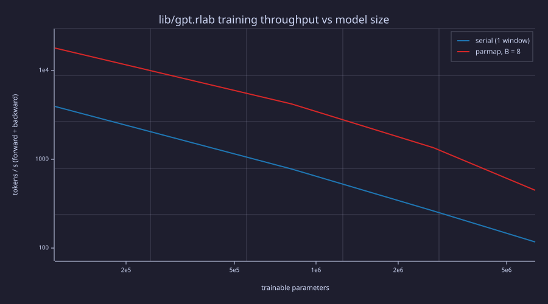

# Sherlock GPT run report

Generated 2026-10-18 17:06 by `report.py` from the logs in `tutorial/sherlock/`.

## Configuration

```
corpus: 562269 chars   vocab: 77    train: 534156   val: 28113
model: d = 128  L = 4  H = 4  d_ff = 512  T = 128   params = 811008
tokens per step: 1024    steps: 3000    total tokens: 3072000   ( 5.7511288836968975 epochs )
```


## Pre-training (`train.rlab`)

| step | train bits/char | tok/s | elapsed s |
|---:|---:|---:|---:|
| 50 | 5.306 | 2740 | 19 |
| 350 | 3.591 | 2727 | 134 |
| 650 | 3.198 | 2685 | 249 |
| 950 | 2.961 | 2690 | 363 |
| 1250 | 2.756 | 2884 | 478 |
| 1550 | 2.591 | 2757 | 587 |
| 1850 | 2.482 | 2354 | 712 |
| 2150 | 2.344 | 2440 | 833 |
| 2450 | 2.303 | 2180 | 966 |
| 2750 | 2.262 | 2310 | 1105 |
| 3000 | 2.235 | 2272 | 1215 |

Held-out loss: first 3.638 bits/char, last **2.203 bits/char** (1.5269 nats). For scale: uniform over the vocabulary is log2(V), the order-0 entropy of this corpus is 4.47 bits/char, a bigram model about 3.3.

Run summary: `3000 steps, 3072000 tokens, 1216 s, 2527 tok/s average`



*Training and held-out loss (bits/char) and gradient norm*

### Sample at the end of training

```text
Sherlock Holmes ears dushed present coult and
the stirned his bullogrusly benitoransed that with see you hains
were wear strared with hile bout as and whitteen with his lone of my dan
whitat ha wa ha deveate, and loy boven eveed in the cesinible befort,
whithists. Came wa gity tow a bovert the todrnised. Thell. Awa
```


## Generation (`generate.rlab`)

```text
rustlab 0.3.9 — interpreting /Users/mike/projects/2026/rustlab_llm-sherlock/tutorial/sherlock/generate.rlab (.rlab)
loaded checkpoints/ckpt_latest.npz  (step 3000 , 811008 params )

=== greedy ===
Sherlock Holmes of the start of the strange of the man of the
more of the strange of the course of the strange of the star of there
whists words the montt tofe tofe tofe tofe tofe tofe tofe tofe tofe to
the severt tofe tofe tofe tofe tofe tofe tofe tofe tofe tofe tofe tofe
tofe tofe tofe tofe tofe tofe tofe tofe to

=== tau = 0.8  top-k = 20  ===
Sherlock Holmes and dinent, with the tell so
much the colots, and the took stuld to crived which had of this
tarmed of my bellent, and ca esomise, and toro extrocy amongting the
thir criecal. The simplent of the even my tonge his afttertion I wam
windoness?"

"It aske toffice."

"We hold this cloine conclouse head 

=== tau = 1.2, no truncation ===
Sherlock Holmes cone, preve iut Then
tot atempove thran wesed with I ament thicks we aboing the week
little of the maasths anno my down by gofesive wherech, befon Stake an thar
yeYep--with a his accnexe' skix abam. I line could his fa fake which
doye; Mron, sust her fou. Hi Nold thakin-sone,' neveding us thicsite
o
```


## Supervised fine-tuning (`sft.rlab`)

Exact-match accuracy on the training questions (greedy decoding):

- accuracy: 43 / 46 = 93.5 %   (4 replay windows per batch, 300 steps, 113 s)

Forgetting probe (held-out corpus loss before/after):

- held-out paraphrase)
- forgetting probe: held-out corpus loss 1.5269 -> 1.6950 nats  (2.203 -> 2.445 bits/char)  delta +0.1681 nats (+0.243 bits/char)



*SFT loss*

### Log tail

```text
   ok   Who is Jabez Wilson's assistant?                     -> Vincent Spaulding
   ok   What is Vincent Spaulding's real name?               -> John Clay
  MISS  How much did the Red-Headed League pay each week?    -> Four poundar
   ok   What did Jabez Wilson copy out for the League?       -> The Encyclopaedia Britannica
   ok   Which bank did John Clay tunnel towards?             -> The City and Suburban Bank
   ok   Who is Mary Sutherland's missing bridegroom?         -> Hosmer Angel
  MISS  Who was really Hosmer Angel?                         -> James Ryder
   ok   Who is accused of killing Charles McCarthy?          -> James McCarthy
   ok   Who really killed Charles McCarthy?                  -> John Turner
   ok   What were Charles McCarthy's dying words about?      -> A rat
   ok   Which inspector works the Boscombe Valley case?      -> Lestrade
   ok   What is sent to the Openshaws as a warning?          -> Five orange pips
   ok   Which letters appear on the orange-pip envelopes?    -> K. K. K.
   ok   What is the name of the ship Holmes traces the pips to? -> The Lone Star
   ok   Who is the beggar Hugh Boone really?                 -> Neville St. Clair
   ok   What is the name of the opium den?                   -> The Bar of Gold
   ok   Inside which bird is the blue carbuncle found?       -> A goose
   ok   To whom does the blue carbuncle belong?              -> The Countess of Morcar
   ok   Who stole the blue carbuncle?                        -> James Ryder
   ok   Who found the hat and the goose?                     -> Peterson
   ok   What is the speckled band?                           -> A swamp adder
   ok   Who is Helen Stoner's stepfather?                    -> Dr. Grimesby Roylott
   ok   Where does Dr. Roylott live?                         -> Stoke Moran
   ok   What does Holmes straighten after Roylott bends it?  -> The poker
   ok   What is the name of the engineer?                    -> Victor Hatherley
   ok   What did the engineer lose?                          -> His thumb
   ok   Who hired Victor Hatherley?                          -> Colonel Lysander Stark
   ok   Who is the noble bachelor?                           -> Lord St. Simon
   ok   Who did Lord St. Simon marry?                        -> Hatty Doran
   ok   How many beryls were missing from the coronet?       -> Three
   ok   Who is the banker in The Beryl Coronet?              -> Alexander Holder
   ok   Who really stole the beryls?                         -> Sir George Burnwell
   ok   Who is the governess at the Copper Beeches?          -> Violet Hunter
   ok   Who employs Violet Hunter?                           -> Jephro Rucastle
   ok   What was Violet Hunter asked to cut?                 -> Her hair
   ok   What is the name of the mastiff at the Copper Beeches? -> Carlo

SFT accuracy: 43 / 46 = 93.5 %   (4 replay windows per batch, 300 steps, 113 s)
forgetting probe: held-out corpus loss 1.5269 -> 1.6950 nats  (2.203 -> 2.445 bits/char)  delta +0.1681 nats (+0.243 bits/char)
Saved checkpoints/ckpt_sft.npz and sft_curves.svg
```


## Questions asked (`ask.rlab`)

```text
rustlab 0.3.9 — interpreting /Users/mike/projects/2026/rustlab_llm-sherlock/tutorial/sherlock/ask.rlab (.rlab)
model: checkpoints/ckpt_sft.npz
Q: Who is the woman?
A: Irene Adler
rustlab 0.3.9 — interpreting /Users/mike/projects/2026/rustlab_llm-sherlock/tutorial/sherlock/ask.rlab (.rlab)
model: checkpoints/ckpt_sft.npz
Q: Where does Holmes live?
A: 221B Baker Street
rustlab 0.3.9 — interpreting /Users/mike/projects/2026/rustlab_llm-sherlock/tutorial/sherlock/ask.rlab (.rlab)
model: checkpoints/ckpt_sft.npz
Q: Who narrates the stories?
A: Dr. Watson
rustlab 0.3.9 — interpreting /Users/mike/projects/2026/rustlab_llm-sherlock/tutorial/sherlock/ask.rlab (.rlab)
model: checkpoints/ckpt_sft.npz
Q: What does Holmes play?
A: The polloker Street
rustlab 0.3.9 — interpreting /Users/mike/projects/2026/rustlab_llm-sherlock/tutorial/sherlock/ask.rlab (.rlab)
model: checkpoints/ckpt_sft.npz
Q: What is the speckled band?
A: A swamp adder
rustlab 0.3.9 — interpreting /Users/mike/projects/2026/rustlab_llm-sherlock/tutorial/sherlock/ask.rlab (.rlab)
model: checkpoints/ckpt_sft.npz
Q: Who is Holmes' brother?
A: Mrs. A swamp adder
```


## Distillation (`distill.rlab`)

```text
hard          held-out 2.5082 nats (3.619 bits/char)
hard step  350 | hard CE 2.5212 nats (3.637 bits/char) | KD loss 0.0000 | |g| 0.542 | eta 9.96e-04 |    25 s
hard step  400 | hard CE 2.4878 nats (3.589 bits/char) | KD loss 0.0000 | |g| 0.547 | eta 7.44e-04 |    28 s
hard          held-out 2.4512 nats (3.536 bits/char)
hard step  450 | hard CE 2.4608 nats (3.550 bits/char) | KD loss 0.0000 | |g| 0.538 | eta 5.21e-04 |    32 s
hard step  500 | hard CE 2.4523 nats (3.538 bits/char) | KD loss 0.0000 | |g| 0.801 | eta 3.48e-04 |    35 s
hard          held-out 2.4123 nats (3.480 bits/char)
hard step  550 | hard CE 2.4411 nats (3.522 bits/char) | KD loss 0.0000 | |g| 0.598 | eta 2.38e-04 |    39 s
hard step  600 | hard CE 2.4148 nats (3.484 bits/char) | KD loss 0.0000 | |g| 0.517 | eta 2.00e-04 |    42 s
hard          held-out 2.3840 nats (3.439 bits/char)
model                     params  nats/char  bits/char
distillation gain: +0.0136 nats (+0.020 bits/char) vs hard targets; gap to teacher 1.217 bits/char   (82 s + 42 s)
```



*Distilled vs hard-target student*


## Benchmark (`benchmark.rlab`)

```text
|---------------|----|----------|
| dlogits loop | 1.53 | 1.5 |
| unpack + grad alloc | 7.47 | 7.3 |
| LM head matmuls | 1.09 | 1.1 |
| LayerNorm bwd (gpt_ln_bwd) | 4.81 | 4.7 |
| cache slice reads | 4.68 | 4.6 |
| LN re-affine (gpt_rows) | 0.83 | 0.8 |
| FFN matmuls (W1, W2) | 35.71 | 34.8 |
| gradient writes | 2.90 | 2.8 |
| gelu grad | 12.50 | 12.2 |
| Wo / Wqkv matmuls | 17.89 | 17.4 |
| attention matmuls (dA dV dQ dK) | 9.54 | 9.3 |
| softmax bwd (elementwise) | 2.27 | 2.2 |
| embedding scatter-add | 1.18 | 1.2 |
| gradient struct build | 0.27 | 0.3 |
| sum of parts | 102.67 | (uninstrumented backward 103.95 ms) |

matmul-bearing parts: 99.5 ms of 153.3 ms (65 %) -> 7.23 GFLOP/s inside those parts; everything else 53.9 ms

--- primitives at the tutorial's shapes (mean of 20 calls) ---
| primitive | shape | ms | GFLOP/s |
|-----------|-------|----|---------|
| layernorm builtin | 128 x 128 | 0.042 | |
| gpt_ln_fwd (library) | 128 x 128 | 0.322 | |
| softmax builtin | 128 x 128 | 0.057 | |
| gelu builtin | 128 x 512 | 0.331 | |
| matmul (128x128)(128x512) | | 2.058 | 8.15 |
| matmul (512x512)(512x512) | | 33.308 | 8.06 |
| attention core, one head | T=128 d_k=32 | 0.379 | 5.53 |
| embedding gather E(ids,:) | 129 rows of 128 | 0.021 | |
| embedding scatter-add loop | 129 rows of 128 | 1.171 | |
| scalar loop iteration | | 0.00017 | (0.17 us) |

--- 4. parmap scaling, default model (serial reference 774 tok/s, logical CPUs 14 ) ---
| B | s per step | tok/s | speedup | efficiency |
|---|-----------|-------|---------|------------|
| 1 | 0.177 | 722 | 0.93 | 93 % |
| 2 | 0.186 | 1379 | 1.78 | 89 % |
| 4 | 0.212 | 2417 | 3.12 | 78 % |
| 8 | 0.264 | 3879 | 5.01 | 63 % |
| 14 | 0.419 | 4277 | 5.53 | 39 % |

--- per-step overhead outside the windows, default model, B = 8 (mean of 20 calls) ---
| step component | ms |
|----------------|----|
| gpt_unflatten (flat -> struct) | 22.49 |
| batch reduction sum(Gm(:,1:n),1)/B | 30.91 |
| gpt_clip | 4.86 |
| gpt_adamw (flat vectors) | 31.32 |
| total per step | 89.59 |

--- 5. memory per configuration (MB = 1e6 bytes) ---
| d | L | params | f64 weights MB | checkpoint MB (theta + m + v) | in-memory complex f64 MB | activation cache MB (T window) |
|---|---|--------|----------------|-------------------------------|--------------------------|--------------------------------|
| 64 | 2 | 109440 | 0.88 | 2.63 | 1.75 | 2.7 |
| 128 | 4 | 811008 | 6.49 | 19.46 | 12.98 | 21.2 |
| 192 | 6 | 2694528 | 21.56 | 64.67 | 43.11 | 47.7 |
| 256 | 8 | 6349824 | 50.80 | 152.40 | 101.60 | 84.7 |

Saved benchmark.svg
```



*Throughput vs model size*

See `docs/sherlock-performance-and-rustlab-requests.md` for the analysis and the rustlab request list.

